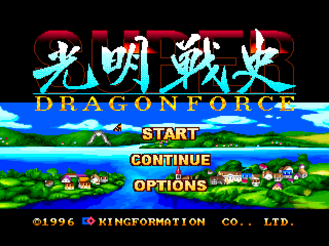
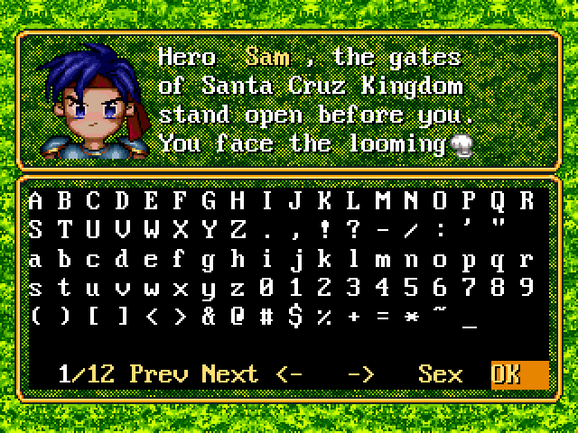
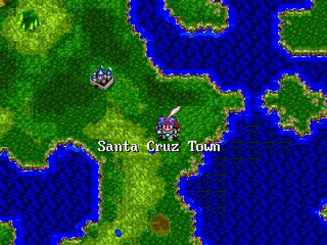
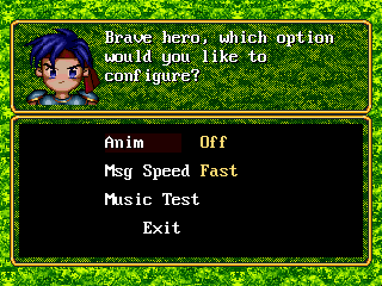

# Super Light Saga: Super Dragon Force (Super A'Can)
## Complete English Translation

### About the Game
*Super Light Saga: Super Dragon Force* (光明戰史, *Guāngmíng Zhànshǐ*) was developed by Kingformation and published by Funtech in 1996 for the **Super A'Can** 16-bit console (Taiwan). It is a rich tactical JRPG powered by an internal Indirect-Threaded Forth virtual machine running on the Motorola 68000 CPU.

This repository provides:
1. **A complete English translation** of the whole game (18 dialogue blocks, 1,655 dialogue entries and 477 short strings).
2. **IPS patches** for both ROM chips (program ROM + data ROM) of the original Taiwan cartridge, and the tools that build them.

To play it you need a Super A'Can emulator: the [Super A'Can Emulator](https://github.com/ACR-GD/superacan-emulator)
(macOS app, Windows, Linux, and a RetroArch core for desktop and Android) or MAME.

### Screenshots

<p>




</p>

---

### Release Files

The translation changes **both** ROM chips of the cartridge: the program ROM (engine patches,
menus, names) and the data ROM (all dialogue). You need both patches.

| Patch | Apply to | Result |
|---|---|---|
| `build/Super-Dragon-Force_EN.ips` | `16007 (Taiwan).bin` (program ROM) | `Super-Dragon-Force_EN.bin` |
| `build/Super-Dragon-Force_DAT_EN.ips` | `08002 (Taiwan).bin` (data ROM) | `Super-Dragon-Force_DAT_EN.bin` |

The patches only apply to the exact dumps below. Check your files before patching
(`build/checksums.txt` also lists the checksums of the patched results):

| File | Size | CRC32 | SHA-1 |
|---|---|---|---|
| `16007 (Taiwan).bin` | 2,097,152 | `56c1c3fb` | `249e2ad6d8d40ecd31eda5a1bd5e5d0f47174a27` |
| `08002 (Taiwan).bin` | 1,048,576 | `fc79f05f` | `7ce2e23ea3fd25764935708be4d47bf1a9843938` |

Any standard IPS tool works (Floating IPS, Lunar IPS, RomPatcher.js). Both files are in the
usual byte-swapped dump format; don't byte-swap them before or after patching.

> **Version 1.0.** Every line of the game is translated, and the build checks that no dialogue
> line overflows its box and no name or menu label is cut off. Play-tested so far: the opening,
> the first town and the first battle in the Super A'Can Emulator, and the opening and first town
> in MAME. Not yet tested on real hardware or MiSTer. Please report any garbled text, overflowing
> menus or crashes.

---

### How to Play

Always use the two patched files together. The patched program ROM with the original data ROM
gives Chinese/garbled dialogue.

- **[Super A'Can Emulator](https://github.com/ACR-GD/superacan-emulator)** (macOS app, Windows /
  Linux, RetroArch core incl. Android): keep `Super-Dragon-Force_EN.bin` and
  `Super-Dragon-Force_DAT_EN.bin` in the same folder, under those names, and open
  `Super-Dragon-Force_EN.bin`. The data ROM is picked up automatically.
- **MAME** (game `slghtsag`): MAME expects the files as `16007.0` and `08007.1`. Put the patched
  files in `roms/supracan/slghtsag/` under those names:
  - `Super-Dragon-Force_EN.bin` → `16007.0`
  - `Super-Dragon-Force_DAT_EN.bin` → `08007.1`

  You also need MAME's Super A'Can system ROMs (`supracan.zip`). Run `mame supracan slghtsag`.
  MAME will warn that the checksums don't match the original set; that's expected.
  *(Tested in MAME 0.289: intro, title menu, hero setup, naming screen, world map and first
  town. `tools/mame_test.sh` repeats this run.)*
- **MiSTer / flash carts:** use the two patched files in place of the originals, with whatever
  file names your setup expects. *(Not yet tested.)*

### Building the Patches Yourself

Put the two original dumps in `Super-Dragon-Force_Super-Acan_ZH-TW/`, then run:

```bash
python3 tools/dump_script.py   # reads the Chinese script from your ROMs into notes/*_zh.*
python3 tools/build_rom.py
```

(The Chinese script dumps are generated from your own ROMs and are not part of this repository.)

This writes both patched ROMs, both IPS patches and `checksums.txt` to `build/`. The build
fails if a patch doesn't reproduce the patched ROM exactly or if any dialogue line would
overflow its text box. It also checks names, items, spells and menu labels against the width
of the on-screen fields that display them (the game cuts longer strings off) and lists any
problems in `build/string_report.txt`; `python3 tools/build_rom.py --strict` turns those into
errors. Release builds should pass `--strict`.

---

### Project Structure
- `tools/`: Translation and reverse-engineering pipeline.
  - `build_rom.py`: One-command ROM builder and IPS patch generator.
  - `forth.py`: Super A'Can Forth VM disassembler (writes `notes/forth_listing.txt`).
  - `dump_script.py`: dumps the Chinese script from the ROMs (`notes/*_zh.*`).
  - `lzss.py`: Bit-exact Super Dragon Force LZSS compressor/decompressor.
  - `dialogue_data/`: Complete Python dialogue translation modules (blocks 01–17).
- `notes/`: Translation databases and glossary.
  - `dialogue_en.json`: All 1,655 dialogue entries in English.
  - `short_strings_en.json`: All 477 short strings in English.
  - `glossary.json`: Terminology glossary.

---

### License

The tools, translation and patches are MIT-licensed (see `LICENSE`). The game itself is not
included; you need your own dump.
